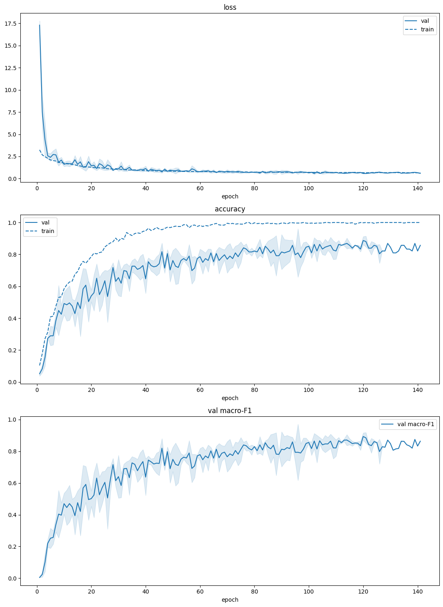
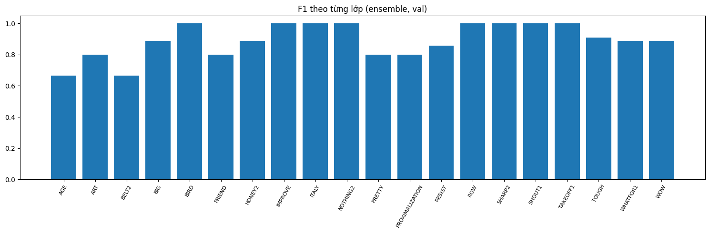
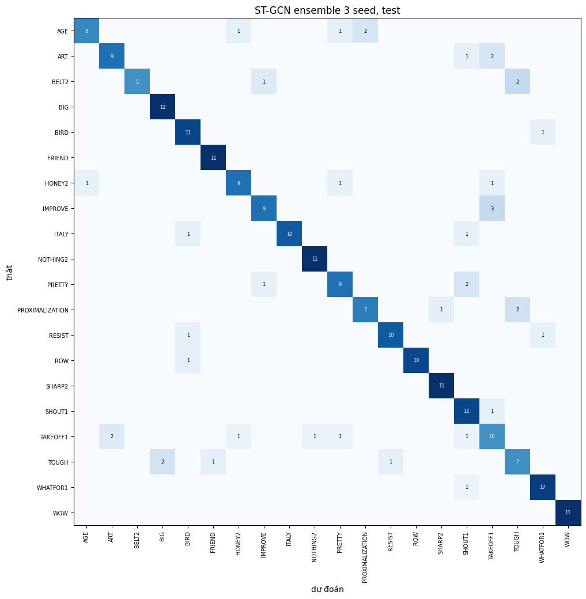

# Isolated ASL Sign Recognition from MediaPipe Keypoints (ST-GCN)

  

Skeleton-based recognition of 20 isolated American Sign Language signs from the [ASL Citizen](https://www.microsoft.com/en-us/research/project/asl-citizen/) dataset. Videos are turned into MediaPipe Holistic keypoint sequences, and a spatial-temporal graph convolutional network (ST-GCN) is trained from scratch on them. Course project (Deep Learning), team of 5. This repository contains the preprocessing scripts and the final ST-GCN training and evaluation notebook.

## Key results

- **Test split (238 clips, 11 signers never seen in training):** 0.832 accuracy and 0.833 macro-F1 for the 3-seed ensemble; 0.787 accuracy and 0.783 macro-F1 on average for a single seed.
- **Top-3 / top-5 accuracy** of the ensemble: 0.937 / 0.971.
- ST-GCN (10.8M parameters) gave the best validation macro-F1 among ST-GCN, Conformer and BiGRU, all trained from scratch under the same 3-seed protocol in the course project.

## Pipeline

```
video -> MediaPipe Holistic keypoints (N x 107) -> preprocess/preprocess_v2.py -> 64 x 100 features + hand mask
      -> preprocess/build_data_v2.py (data.npz) -> ST-GCN (notebooks/) -> softmax over 20 signs
```

## Repository structure

```
.
├── notebooks/
│   └── asl_stgcn_final.ipynb   # ST-GCN training, evaluation, error analysis, TorchScript export
├── preprocess/
│   ├── preprocess_v2.py        # per-video keypoint preprocessing (trim, interpolate, normalize, resample to 64 frames)
│   └── build_data_v2.py        # packs all videos into train/val/test .npz, checks signer-independent split
├── figures/                    # plots used in this README
├── requirements.txt
├── LICENSE
└── README.md
```

## Data preparation

The ASL Citizen videos and the extracted keypoints are not included. The MediaPipe extraction step is not part of this repository either; the scripts below start from per-video raw keypoint files.

**Input:** one array of shape (N, 107) per video (hands x,y for both hands, 7 pose points with visibility, 2 unused flag columns), or an `.npz` with `hands` and `pose`, listed in a `manifest.csv` with the columns `sample_id, participant_id, split, label, raw_path` (optional: `width, height, fps`).

**What `preprocess_v2.py` does:**

- trims the clip to the active signing segment using hand and arm motion;
- interpolates frames where MediaPipe lost a hand and records a per-frame hand-visible mask;
- normalizes hand landmarks relative to the wrist and hand size, and arm/nose points relative to the shoulders and shoulder width;
- resamples every clip to 64 frames, giving 100 features per frame (the notebook appends the 2 mask channels, 102 in total);
- assigns a status: clips with no usable shoulders, no hand, or fewer than 8 frames are dropped, and clips with the hand visible in under half of the frames are flagged `LOW_HAND`.

**Commands (run from `preprocess/`):**

```bash
# 1) build manifest.csv from raw keypoints and the extraction log
python build_data_v2.py --make-manifest raw_keypoints extract_log.csv

# 2) plot the trimming threshold on a sample of TRAIN clips (writes trim_check.png)
python build_data_v2.py --manifest manifest.csv --plot-trim 12

# 3) pack the dataset (use this file name: the notebook looks for data.npz and data.meta.csv)
python build_data_v2.py --manifest manifest.csv --out data.npz

# optional: random fake data with the same format, for testing the training code
python build_data_v2.py --fake 120 --out data_fake.npz
```

The packing step also writes `signs.json` (label to index, sorted A-Z), `data.meta.csv` and `data.dropped.csv`, and asserts that no signer appears in more than one split.

## Method

- ST-GCN backbone from [MMAction2](https://github.com/open-mmlab/mmaction2) (base_channels=120, 10.8M parameters) on a 49-node graph (two hands and upper-body joints). Input channels: position, size/visibility flags and two frame differences.
- Training: AdamW (lr 1e-3), batch size 32, up to 200 epochs, early stopping (patience 30) on validation macro-F1, label smoothing 0.1, head dropout 0.5, gradient clipping 1.0.
- 3 seeds (0, 1, 2); the final prediction is the mean of the three softmax outputs.
- Metrics: accuracy, macro-F1, top-3 / top-5, Wilson 95% CI, expected calibration error, per-class F1, confusion pairs, OK vs LOW_HAND breakdown.

## Results

| Split | Model | Accuracy | Macro-F1 |
|---|---|---|---|
| Val (84 clips, 5 signers) | ST-GCN, mean of 3 seeds | 0.889 | 0.893 |
| Val (84 clips, 5 signers) | ST-GCN, 3-seed ensemble | 0.893 | 0.893 |
| Test (238 clips, 11 unseen signers) | ST-GCN, mean of 3 seeds | 0.787 | 0.783 |
| Test (238 clips, 11 unseen signers) | ST-GCN, 3-seed ensemble | 0.832 | 0.833 |

The test split is evaluated once, guarded by a lock file in the notebook (40 errors out of 238 clips).

### Figures

Learning curves (mean and std over 3 seeds):



Per-class F1 on validation (ensemble):



Confusion matrix on the test split (3-seed ensemble, 11 unseen signers):



## How to run

1. Prepare `data.npz`, `signs.json` and `data.meta.csv` as described above, or attach an equivalent dataset on Kaggle.
2. Install dependencies: `pip install -r requirements.txt` (the notebook also installs `mmengine`, `mmcv-lite==2.1.0` and `mmaction2 --no-deps` in cell 3b).
3. Open `notebooks/asl_stgcn_final.ipynb` on a GPU machine (it was run on Kaggle, T4 x2, about 58 minutes) and run all cells. Outputs go to `results/`: per-seed checkpoints and histories, `summary.csv`, `val_summary.csv`, `test_metrics.csv`, confusion matrices, per-class F1, error lists, and a TorchScript export (`stgcn_asl20_ensemble.pt`, `stgcn_asl20_single.pt`).

Kaggle notebook (with outputs): https://www.kaggle.com/code/stayhome3977/asl-stgcn-final-thoang

## Reference

Desai et al., "ASL Citizen: A Community-Sourced Dataset for Advancing Isolated Sign Language Recognition", NeurIPS 2023 (Datasets and Benchmarks), [arXiv:2304.05934](https://arxiv.org/abs/2304.05934).

## License

Apache License 2.0, see [LICENSE](LICENSE).
